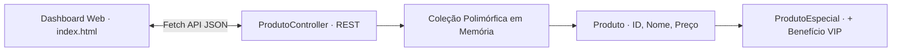

<p align="center">
  
</p>

<h1 align="center">spring-boot-product-manager</h1>

<p align="center">Gestão de produtos com API REST, painel web e modelagem orientada a objetos.</p>

<p align="center">
  
  
  
</p>

<p align="center"><a href="#visão-geral">Visão geral</a> &nbsp;·&nbsp; <a href="#recursos">Recursos</a> &nbsp;·&nbsp; <a href="#como-executar">Como executar</a></p>

---

## Visão geral

O diferencial técnico do projeto está na aplicação prática de **Programação Orientada a Objetos (POO)** dentro de uma API web: a classe base Produto (id, nome, preco) é estendida pela subclasse ProdutoEspecial (que adiciona o atributo exclusivo beneficio), permitindo gerenciar tanto itens convencionais quanto produtos VIP no mesmo inventário polimórfico.

## Recursos

| Recurso | Como funciona |
|---|---|
| CRUD RESTful Completo | ProdutoController expõe rotas para listar, cadastrar, atualizar e remover produtos do inventário. |
| Herança e Polimorfismo em POO | ProdutoEspecial extends Produto herda os atributos base e acrescenta regras e benefícios exclusivos para itens VIP. |
| Dashboard Web Integrado | Interface responsiva em static/index.html e static/style.css que consome a API via fetch e diferencia visualmente cards normais e VIP. |
| Execução Zero-Config | Armazenamento em memória estruturado em coleções para execução imediata com um único comando, sem exigir banco externo. |

## Tecnologias

- **Java 17 & Spring Boot Web** para exposição dos endpoints REST e servidor Tomcat embutido;
- **HTML5, CSS3 & Vanilla JavaScript** para renderização dinâmica dos cards de produtos;
- **Maven Wrapper (mvnw / mvnw.cmd)** para compilação e execução em qualquer plataforma.

<details>
<summary>Arquitetura</summary>



</details>

<details>
<summary>Estrutura do repositório</summary>

```text
spring-boot-product-manager/
├── assets/
│   └── project-animal.png          Emblema do projeto
├── Produtos POO/
│   ├── src/main/java/com/projetomusica/demo/
│   │   ├── controller/ProdutoController.java       Endpoints REST do inventário
│   │   ├── model/Produto.java                      Superclasse base de produtos
│   │   ├── model/ProdutoEspecial.java              Subclasse VIP (Herança)
│   │   └── DemoApplication.java                    Inicialização do Spring Boot
│   ├── src/main/resources/static/
│   │   ├── index.html                              Painel interativo Full-Stack
│   │   └── style.css                               Estilização do dashboard e cards
│   └── pom.xml                                     Configuração Maven e Java 17
└── README.md
```

</details>

## Como executar

1. Clone o repositório e acesse o diretório Maven:
   ```powershell
   git clone https://github.com/arthurlynow098/spring-boot-product-manager.git
   cd "spring-boot-product-manager/Produtos POO"
   ```
2. Inicie o servidor Spring Boot:
   ```powershell
   .\mvnw.cmd spring-boot:run
   ```
   *(No Linux/macOS, utilize ./mvnw spring-boot:run).*
3. Abra http://localhost:8080 no navegador para interagir com o dashboard e cadastrar produtos normais e especiais.

## Decisões técnicas

- **Front-end servido pelo Spring Boot (resources/static):** elimina problemas de CORS durante o desenvolvimento e entrega a aplicação inteira na porta 8080.
- **Polimorfismo na camada de modelo:** demonstra como a orientação a objetos evita duplicação de código entre categorias de produtos que compartilham a mesma identidade.

---

<p align="center">
  <a href="https://github.com/arthurlynow098">GitHub</a> &nbsp;·&nbsp;
  <a href="https://arthurentsev.vercel.app/">Portfólio</a> &nbsp;·&nbsp;
  <a href="https://www.linkedin.com/in/entsevarthur/">LinkedIn</a>
</p>
