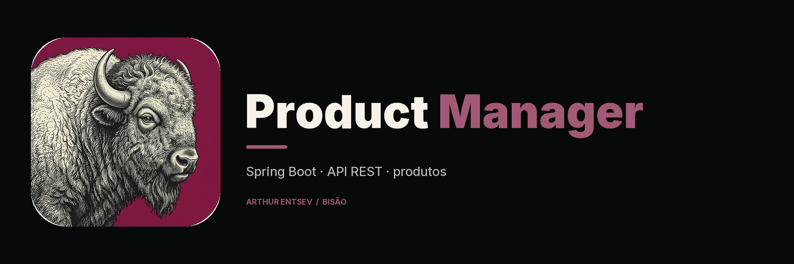
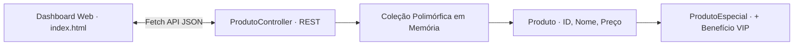
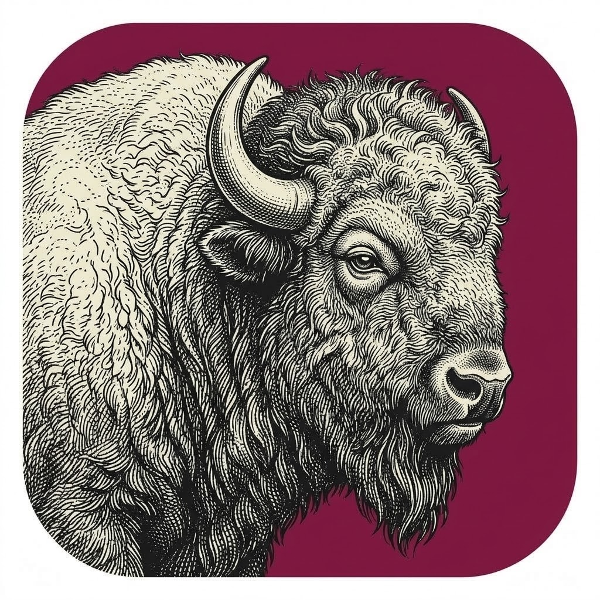

<a id="top"></a>

<p align="center"></p>

<p align="center">Gestão de produtos com API REST, painel web e modelagem orientada a objetos.</p>

<p align="center">


</p>


<p align="center"><a href="#visão-geral">Visão geral</a> &nbsp;·&nbsp; <a href="#recursos">Recursos</a> &nbsp;·&nbsp; <a href="#como-executar">Como executar</a></p>


<a id="explore-o-projeto"></a>

<a id="por-onde-começar"></a>

<p></p>


- **[API](Produtos%20POO/src/main/java/com/projetomusica/demo/controller/ProdutoController.java)** — Controlador de produtos.
- **[Modelo](Produtos%20POO/src/main/java/com/projetomusica/demo/model/Produto.java)** — Classe base dos produtos.
- **[Painel](Produtos%20POO/src/main/resources/static/index.html)** — Interface web servida pela aplicação.


<a id="visão-geral"></a>

<a id="sobre-o-projeto"></a>

<p></p>

O diferencial técnico do projeto está na aplicação prática de **Programação Orientada a Objetos (POO)** dentro de uma API web: a classe base Produto (id, nome, preco) é estendida pela subclasse ProdutoEspecial (que adiciona o atributo exclusivo beneficio), permitindo gerenciar tanto itens convencionais quanto produtos VIP no mesmo inventário polimórfico.

<a id="recursos"></a>


<p></p>

**CRUD RESTful Completo**<br>
ProdutoController expõe rotas para listar, cadastrar, atualizar e remover produtos do inventário.

**Herança e Polimorfismo em POO**<br>
ProdutoEspecial extends Produto herda os atributos base e acrescenta regras e benefícios exclusivos para itens VIP.

**Dashboard Web Integrado**<br>
Interface responsiva em static/index.html e static/style.css que consome a API via fetch e diferencia visualmente cards normais e VIP.

**Execução Zero-Config**<br>
Armazenamento em memória estruturado em coleções para execução imediata com um único comando, sem exigir banco externo.

<a id="tecnologias"></a>


<p></p>

- **Java 17 & Spring Boot Web** para exposição dos endpoints REST e servidor Tomcat embutido;
- **HTML5, CSS3 & Vanilla JavaScript** para renderização dinâmica dos cards de produtos;
- **Maven Wrapper (mvnw / mvnw.cmd)** para compilação e execução em qualquer plataforma.

<a id="arquitetura"></a>

<p></p>





<a id="estrutura-do-repositório"></a>

<p></p>


```text
spring-boot-product-manager/
├── assets/
│   └── identity/banner.png               Banner do projeto
├── Produtos POO/
│   ├── src/main/java/com/projetomusica/demo/
│   │   ├── controller/ProdutoController.java       Endpoints REST do inventário
│   │   ├── model/Produto.java                      Superclasse base de produtos
│   │   ├── model/ProdutoEspecial.java              Subclasse VIP (Herança)
│   │   └── DemoApplication.java                    Inicialização do Spring Boot
│   ├── src/main/resources/static/
│   │   ├── index.html                              Painel interativo Full-Stack
│   │   └── style.css                               Estilização do dashboard e cards
│   └── pom.xml                                     Configuração Maven e Java 17
└── README.md
```


<a id="como-executar"></a>


<p></p>

1. Clone o repositório e acesse o diretório Maven:
   ```powershell
   git clone https://github.com/arthurlynow098/spring-boot-product-manager.git
   cd "spring-boot-product-manager/Produtos POO"
   ```
2. Inicie o servidor Spring Boot:
   ```powershell
   .\mvnw.cmd spring-boot:run
   ```
   *(No Linux/macOS, utilize ./mvnw spring-boot:run).*
3. Abra http://localhost:8080 no navegador para interagir com o dashboard e cadastrar produtos normais e especiais.

<a id="decisões-técnicas"></a>


<p></p>

- **Front-end servido pelo Spring Boot (resources/static):** elimina problemas de CORS durante o desenvolvimento e entrega a aplicação inteira na porta 8080.
- **Polimorfismo na camada de modelo:** demonstra como a orientação a objetos evita duplicação de código entre categorias de produtos que compartilham a mesma identidade.


<p align="center">
  <a href="https://github.com/arthurlynow098">GitHub</a> &nbsp;·&nbsp;
  <a href="https://arthurentsev.vercel.app/">Portfólio</a> &nbsp;·&nbsp;
  <a href="https://www.linkedin.com/in/entsevarthur/">LinkedIn</a>
</p>


<a id="identidade-e-créditos"></a>

<p></p>

<table><tr><td width="150"></td><td><strong>Bisão</strong><br>Força e estrutura para organizar o catálogo.<br><br><a href="assets/identity-v2/logo.png">Logo em PNG</a> · <a href="assets/identity-v2/banner.png">Banner em PNG</a></td></tr></table>

Artes da coleção fornecida por **Arthur Entsev**, com adaptação das logos e acabamento dos banners realizados com auxílio de geração de imagens. Referências de identidade e apresentação: [LynowCut](https://github.com/arthurlynow098/LynowCut), [LynowMic](https://github.com/arthurlynow098/LynowMic) e [LynowCatch](https://github.com/arthurlynow098/LynowCatch). Os créditos e avisos do conteúdo original foram preservados.

<p align="center"><a href="#top">Voltar ao topo ↑</a> · <a href="https://github.com/arthurlynow098">Arthur Entsev</a> · <a href="https://arthurentsev.vercel.app/">Portfólio</a></p>
